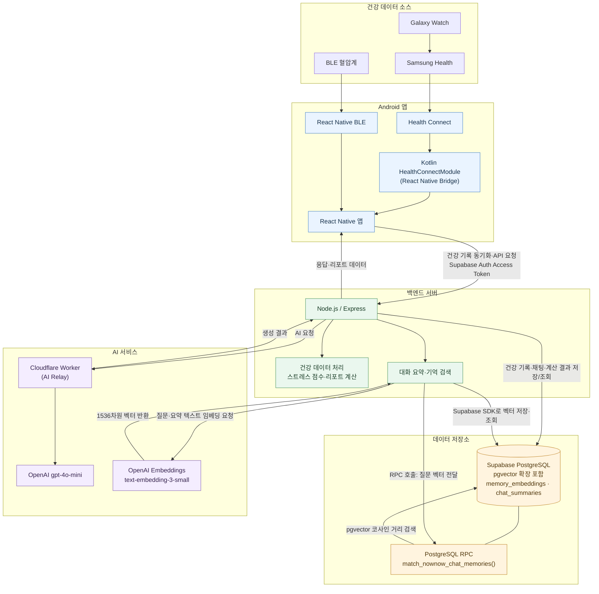

# NowNow (나우나우)

<p align="center">
  
</p>

<p align="center">
  <strong>스마트워치 건강 데이터로 스트레스 변화를 살펴보고,<br />
  나를 기억하는 AI 캐릭터와 대화하며 일상 속 관리를 돕는 웰니스 앱</strong>
</p>

<p align="center">
  
  
  
  
  
  
  
</p>

---

## 목차

- [프로젝트 소개](#프로젝트-소개)
- [기획 배경](#기획-배경)
- [주요 기능](#주요-기능)
- [시스템 아키텍처](#시스템-아키텍처)
- [기술 스택](#기술-스택)
- [프로젝트 구조](#프로젝트-구조)
- [실행 방법](#실행-방법)
- [Health Connect 연동](#health-connect-연동)
- [혈압계 연동](#혈압계-연동)
- [테스트](#테스트)
- [팀 구성 및 담당 업무](#팀-구성-및-담당-업무)
- [기술적 의사결정과 트러블슈팅](#기술적-의사결정과-트러블슈팅)
- [향후 개선 사항](#향후-개선-사항)

---

## 프로젝트 소개

**NowNow**는 스마트워치와 건강 플랫폼에 쌓이는 생체 데이터를 바탕으로 사용자의 스트레스 변화를 확인하고, AI 캐릭터 '뿡뿡이'와의 대화를 통해 일상적인 정서 관리를 돕는 Android 웰니스 애플리케이션입니다.

건강 수치를 단순히 나열하는 데 그치지 않고, 건강 기록과 대화 내용을 함께 활용해 사용자가 자신의 컨디션과 스트레스 상황을 돌아볼 수 있도록 설계했습니다.

- **플랫폼:** Android
- **클라이언트:** React Native
- **서버:** Node.js / Express, Cloudflare Workers
- **데이터 저장:** Supabase PostgreSQL
- **건강 데이터 연동:** Health Connect

## 기획 배경

서울대학교 보건대학원의 연구에 따르면 조사 대상 1,500명 중 38.1%가 스트레스를 경험했을 때 별다른 대처 없이 혼자 참는다고 응답하였다. 스트레스 해소를 위해 전문 상담이나 정신건강의학과 진료를 받을 수 있지만, 사회적 편견에 대한 부담, 상담 비용, 예약 절차의 불편함, 시간적 제약 등으로 인해 실제 이용까지 이어지지 않는 경우가 많다.

한편, 2024년 기준 국내 우울증 환자 수는 약 110만 명으로 5년 전 대비 약 33% 증가하였다. 반면 사회조사에서는 스트레스 인지율이 감소하는 경향이 나타났다. 이는 스트레스가 실제로 감소한 것이 아니라, 개인이 자신의 스트레스 상태를 정확히 인지하지 못하거나 적절히 대처하지 못하는 경우가 많아졌다고 볼 수 있다. 즉, 많은 사람들이 스트레스를 경험하면서도 이를 관리하지 못한 채 방치하고 있으며, 이는 우울감 및 정신건강 악화로 이어질 수 있다.

이에 해결책으로 본 프로젝트는 웨어러블 기기에 주목했다. 사용자의 일상 속에서 보다 쉽고 지속적으로 스트레스를 관리할 수 있다. 특히 스마트워치는 항상 착용하는 웨어러블 기기로서 사용자의 생체 신호를 실시간으로 수집할 수 있으며, 즉각적인 알림과 상호작용을 제공할 수 있다는 장점을 가진다. 또한 2024년 국내 스마트워치 보급률은 약 33% 수준으로 지속적으로 증가하고 있으며, 건강 관리 애플리케이션에 대한 이용자 관심 또한 높아지고 있다.

현재 시중에는 스트레스 측정 기능을 제공하는 서비스(Welltory, 삼성 헬스 등)가 존재하지만, 대부분 측정 결과를 단순 제공하는 수준에 머물러 있다. 사용자의 스트레스 상태를 지속적으로 모니터링하고, 개인 맞춤형 관리와 정서적 케어까지 제공하는 서비스는 상대적으로 부족한 상황이다.

NowNow는 이러한 문제를 해결하기 위해 스마트워치 건강 데이터 기반 스트레스 모니터링과 AI 캐릭터를 통한 개인화된 정서 관리를 연결하고자 한다.

1. **상태 확인:** 스마트워치에서 수집한 건강 데이터를 바탕으로 스트레스 변화를 확인합니다.
2. **상황 회고:** 하루 동안의 대화를 정리하고 스트레스 원인 키워드를 기록합니다.
3. **개인화된 상호작용:** 과거 대화 요약과 취향을 참고하는 AI 캐릭터와 대화합니다.
4. **행동 제안:** 휴식·음악·영상 등 일상에서 시도할 수 있는 활동을 제안합니다.

## 주요 기능

### 1. 건강 데이터 수집 및 스트레스 지수

- Health Connect를 통해 걸음 수, 심박수, 산소포화도, 혈압, 수면 데이터를 조회합니다.
- 심박수의 시간대별 평균과 표준편차 기반 pseudo-HRV를 이용해 시간대별 스트레스 값을 계산합니다.
- 걸음 수·혈압·수면 정보를 추가 반영해 일일 스트레스 지수를 산출합니다.
- 스트레스 계산은 서버에서 수행하며 계산 결과와 세부 지표를 리포트에 제공합니다.

> Health Connect에서 ECG 원시 데이터와 RR 간격을 직접 제공받지 못하는 환경을 고려해, 본 프로젝트의 pseudo-HRV는 심박수 표준편차를 활용한 대체 지표입니다. 의료적 진단이나 임상적 HRV 측정을 의미하지 않습니다.

### 2. 실시간·월간 리포트

- **실시간 리포트:** 오늘의 심박수, 걸음 수, 수면, 혈압, 산소포화도와 시간대별 스트레스 흐름을 확인합니다.
- **월간 리포트:** 월평균 스트레스, 고스트레스 날짜, 수면·걸음 수 평균, 달력 기반 스트레스 분포를 확인합니다.
- 데이터가 충분하지 않은 항목은 임의의 건강 측정값으로 대체하지 않습니다.

### 3. AI 캐릭터 채팅

- AI 캐릭터 '뿡뿡이'와 자연어로 대화합니다.
- 건강 기록, 사용자의 취향, 최근 대화 및 과거 대화 요약을 참고해 응답합니다.
- 대화 흐름에 맞춰 명상·스트레칭 영상, 음식·배달, 음악, 영화 등의 활동을 제안합니다.
- 하루 대화를 요약하고 감정 및 스트레스 원인 키워드를 정리할 수 있습니다.
- 위험 신호가 감지되는 경우 전문적인 도움을 안내하는 안전 가드레일을 적용합니다.

### 4. 대화 기억 검색

- 일정 기간의 대화를 요약해 임베딩으로 저장합니다.
- 사용자의 질문과 과거 대화 요약 간 의미적 유사도를 계산합니다.
- 관련성이 높은 기억을 선별해 AI 답변 생성 문맥으로 전달합니다.
- 임베딩 검색 기능은 OpenAI 임베딩 API와 Supabase pgvector를 사용합니다.

### 5. 캐릭터 성장 및 취향 반영

- 홈 화면에서 밥주기·놀이·음악·휴식 등의 행동을 선택합니다.
- 선택 기록을 저장해 캐릭터의 경험치와 레벨에 반영합니다.
- 행동 선택과 취향 정보를 AI 대화의 개인화 문맥으로 활용합니다.
- 음악 추천은 YouTube Data API를 이용합니다.

### 6. 혈압 기록

- 혈압을 직접 입력할 수 있습니다.
- 오므론 혈압계의 Health Connect 연동 기록을 조회할 수 있습니다.
- 지원되는 BLE 혈압계에서 측정값을 직접 수신하는 기능도 구현했습니다. 단, 직접 BLE 연결은 기기별 실측 검증이 추가로 필요합니다.

### 7. 사용자 설정

- 프로필과 별명, MBTI 및 활동·음식·음악 취향을 관리합니다.
- 알림 설정과 앱 테마를 변경할 수 있습니다.
- 건강 데이터 및 앱 권한 상태를 확인할 수 있습니다.

---

## 시스템 아키텍처



### 데이터베이스 ERD

Supabase PostgreSQL의 사용자별 데이터 구조와 확인 가능한 외래 키 관계를 나타냅니다. `auth.users`를 기준으로 사용자 프로필, 건강 원본 기록, 스트레스 계산 결과, 대화 데이터 및 앱 설정 데이터를 관리합니다.

```mermaid
erDiagram
    AUTH_USERS ||--o{ USER_INFORMATIONS : "user_id"
    AUTH_USERS ||--o{ HEART_RATE_RECORDS : "user_id"
    AUTH_USERS ||--o{ STEPS_RECORDS : "user_id"
    AUTH_USERS ||--o{ BLOOD_PRESSURE_RECORDS : "user_id"
    AUTH_USERS ||--o{ OXYGEN_RECORDS : "user_id"
    AUTH_USERS ||--o{ SLEEP_RECORDS : "user_id"
    AUTH_USERS ||--o{ DAILY_STRESS_SCORES : "user_id"
    AUTH_USERS ||--o{ DAILY_MOODS : "user_id"
    AUTH_USERS ||--o{ CHAT_MESSAGES : "user_id"
    AUTH_USERS ||--o{ CHAT_SUMMARIES : "user_id"
    AUTH_USERS ||--o{ MEMORY_EMBEDDINGS : "user_id"
    AUTH_USERS ||--o{ CHARACTER_INTERACTIONS : "user_id"
    AUTH_USERS ||--o{ PUSH_TOKENS : "user_id"
    AUTH_USERS ||--o{ HEALTH_REPORTS : "user_id"

    CHAT_SUMMARIES ||--o| MEMORY_EMBEDDINGS : "nownow_summary_id"

    AUTH_USERS {
        uuid id PK
    }
    USER_INFORMATIONS {
        uuid user_id FK
        text status_message
        smallint stress_threshold
        time notify_time
    }
    HEART_RATE_RECORDS {
        uuid user_id FK
        text source_record_id
        text data_origin
        timestamptz measured_at
    }
    STEPS_RECORDS {
        uuid user_id FK
        timestamptz start_time
        timestamptz end_time
    }
    BLOOD_PRESSURE_RECORDS {
        uuid user_id FK
        text source_record_id
        text data_origin
        timestamptz measured_at
    }
    OXYGEN_RECORDS {
        uuid user_id FK
        text source_record_id
        text data_origin
        timestamptz measured_at
    }
    SLEEP_RECORDS {
        bigint sleep_id PK
        uuid user_id FK
        timestamptz start_time
        timestamptz end_time
        integer duration_minutes
    }
    DAILY_STRESS_SCORES {
        bigint daily_stress_id PK
        uuid user_id FK
        date record_date
        numeric final_score
        text_array missing
    }
    DAILY_MOODS {
        bigint mood_id PK
        uuid user_id FK
        date record_date
        text mood
    }
    CHAT_MESSAGES {
        uuid user_id FK
        timestamptz created_at
    }
    CHAT_SUMMARIES {
        bigint summary_id PK
        uuid user_id FK
        text_array keywords
        timestamptz created_at
    }
    MEMORY_EMBEDDINGS {
        uuid user_id FK
        bigint nownow_summary_id FK
        vector embedding
    }
    CHARACTER_INTERACTIONS {
        bigint interaction_id PK
        uuid user_id FK
        text action
        text choice
    }
    PUSH_TOKENS {
        bigint push_token_id PK
        uuid user_id FK
        text token
        text platform
    }
    HEALTH_REPORTS {
        uuid user_id FK
        timestamptz measured_at
    }
```



- **건강 원본 데이터:** 심박수·걸음 수·혈압·산소포화도·수면 기록을 사용자별로 저장합니다. Health Connect 증분 동기화 데이터는 지원 테이블에 원본 레코드 ID와 데이터 출처를 함께 기록합니다.
- **스트레스 결과:** `daily_stress_scores`에 날짜별 계산 결과와 계산에 사용한 지표, 누락 데이터 정보를 저장합니다. 점수는 백엔드에서 계산하고 앱은 조회합니다.
- **대화 및 기억:** `chat_messages`와 `chat_summaries`를 사용자별로 관리하며, `memory_embeddings.nownow_summary_id`가 요약 테이블을 참조해 pgvector 유사도 검색에 사용됩니다.
- **앱 상태:** 기분 기록, 캐릭터 상호작용, 푸시 토큰을 사용자별로 분리해 저장합니다.

> ERD는 저장소의 SQL 마이그레이션에서 확인되는 테이블과 FK를 중심으로 정리한 논리 구조입니다. 전체 컬럼을 나열한 물리 스키마 덤프는 아니며, 실제 DB에만 존재하거나 마이그레이션 파일에서 관계를 확인할 수 없는 테이블·컬럼은 생략했습니다.

### 데이터 처리 흐름

1. 앱이 Health Connect에서 건강 기록을 읽습니다.
2. 변경된 건강 기록을 인증 토큰과 함께 Express 백엔드로 전송합니다.
3. 백엔드는 Supabase Auth 토큰을 검증하고 인증된 사용자 기준으로 데이터를 저장합니다.
4. 스트레스 점수와 리포트 데이터는 백엔드 서비스에서 계산합니다.
5. AI가 필요한 요청은 백엔드가 사용자 건강 기록·대화 기억·취향을 구성해 Cloudflare Worker로 전달합니다.
6. Worker가 OpenAI API를 호출하고 결과를 백엔드에 반환합니다.

**보안 원칙**
- 앱에서 Supabase 데이터베이스에 직접 쓰지 않고 백엔드 API를 통해 저장합니다.
- 사용자 식별은 클라이언트가 전달한 사용자 ID를 신뢰하지 않고 Supabase 인증 토큰을 검증해 처리합니다.
- OpenAI 키, AI 릴레이 토큰, Supabase 서비스 키 등 비밀값은 앱 코드와 저장소에 포함하지 않습니다.

### 주요 API

| 경로 | 기능 |
|---|---|
| `/api/auth` | 회원가입 및 로그인 |
| `/api/me` | 프로필·취향·설정 관리 |
| `/api/health` | 건강 기록 저장·조회·동기화 |
| `/api/chat` | 대화 저장·답변 중계·하루 요약 |
| `/api/reports` | 실시간·월간 리포트 및 추천 |
| `/api/stress` | 시간대별·일일 스트레스 점수 |
| `/api/moods` | 날짜별 기분 기록 |
| `/api/character` | 캐릭터 행동·경험치·레벨 |
| `/api/music` | 음악 추천 |

세부 요청·응답 형식은 [백엔드 API 요구사항](docs/backend-api-requirements.md)을 참고하세요.

---

## 기술 스택

| 구분 | 기술 |
|---|---|
| 모바일 앱 | React Native 0.85.3, React 19, TypeScript 5.9.3 |
| Android 네이티브 | Kotlin, Health Connect, Kotlin Coroutines |
| 블루투스 | react-native-ble-plx |
| 서버 | Node.js 22, Express 5 |
| 인증·데이터베이스 | Supabase Auth, PostgreSQL |
| 벡터 검색 | pgvector |
| 생성형 AI | Cloudflare Workers, OpenAI gpt-4o-mini |
| 임베딩 | OpenAI text-embedding-3-small |
| 외부 API | YouTube Data API v3 |
| UI 및 차트 | React Navigation, react-native-svg, lucide-react-native |

---

## 프로젝트 구조

```text
.
├── android/
│   └── app/src/main/java/com/mibandtest/
│       ├── HealthConnectModule.kt
│       └── HealthConnectPackage.kt
├── backend/
│   ├── controllers/
│   ├── routes/
│   ├── services/
│   ├── jobs/
│   ├── db/migrations/
│   ├── scripts/
│   └── tests/
├── chatbot-server/
│   └── worker.mjs
├── docs/
│   ├── backend-api-requirements.md
│   ├── background-sync-design.md
│   └── omron-hem-7142t2-integration.md
├── shared/
├── src/
│   ├── navigation/
│   ├── screens/
│   │   ├── Home/
│   │   ├── Chat/
│   │   ├── Report/
│   │   ├── Profile/
│   │   └── Login/
│   ├── services/
│   │   ├── api/
│   │   ├── health/
│   │   ├── notifications/
│   │   └── delivery/
│   ├── theme/
│   └── assets/
└── README.md
```

---

## 실행 방법

### 사전 준비

- Node.js 22
- JDK 17
- Android Studio 및 Android SDK
- Android 기기 또는 에뮬레이터
- Supabase 프로젝트
- Health Connect를 지원하는 Android 환경(실제 건강 데이터 연동 시)

### 1. 백엔드 실행

```bash
cd backend
cp .env.example .env
npm install
npm start
```

테스트:

```bash
npm test
```

백엔드 `.env`에는 프로젝트 설정에 맞는 값을 입력합니다.

| 환경 변수 | 용도 |
|---|---|
| `SUPABASE_URL` | Supabase 프로젝트 URL |
| `SUPABASE_ANON_KEY` | Supabase 공개 클라이언트 키 |
| `SUPABASE_SERVICE_ROLE_KEY` | 서버 전용 서비스 키 |
| `AI_RELAY_URL` | 배포된 Cloudflare Worker 주소 |
| `AI_RELAY_TOKEN` | AI 릴레이 인증 토큰 |
| `OPENAI_API_KEY` | 대화 기억 임베딩 생성용 선택 설정 |
| `YOUTUBE_API_KEY` | 음악 추천용 YouTube Data API 키 |

실제 변수 목록은 `backend/.env.example`을 기준으로 확인하세요. 비밀값이 포함된 `.env` 파일은 커밋하지 않습니다.

### 2. 모바일 앱 실행

저장소 루트에서:

```bash
npm install
npm start
```

별도 터미널에서 Android 앱을 빌드·설치합니다.

```bash
npm run android
```

Windows에서 Gradle 실행 스크립트 인식 문제가 발생하면:

```bash
cd android
gradlew.bat app:installDebug
```

**실기기에서 PC 백엔드에 연결할 경우**

USB 디버깅을 연결한 뒤 포트를 전달합니다.

```bash
adb reverse tcp:8081 tcp:8081
adb reverse tcp:5000 tcp:5000
```

에뮬레이터는 개발 환경에서 PC의 백엔드에 접근할 때 `10.0.2.2`를 사용합니다. 실제 건강 데이터는 Health Connect 권한이 설정된 Android 기기에서 확인할 수 있습니다.

### 3. AI 서버 배포

```bash
cd chatbot-server
node --test
npx wrangler secret put OPENAI_API_KEY
npx wrangler secret put DEMO_TOKEN
npx wrangler deploy
```

- `DEMO_TOKEN`은 백엔드의 `AI_RELAY_TOKEN`과 동일하게 설정합니다.
- 배포 후 Worker 주소를 백엔드 `AI_RELAY_URL`에 설정합니다.
- API 키와 토큰을 소스 코드에 직접 작성하지 않습니다.

---

## Health Connect 연동

### 연동 방식

초기에는 Samsung Health SDK를 통해 갤럭시워치 데이터를 직접 읽는 방식을 검토했습니다. 하지만 SDK 사용을 위한 파트너 승인 절차를 프로젝트 기간 안에 완료하기 어려워 Health Connect 기반으로 변경했습니다.

Samsung Health가 Health Connect에 동기화한 데이터를 앱의 Kotlin 네이티브 모듈에서 조회하고, React Native Bridge를 통해 JavaScript 코드로 전달합니다.

### 수집 데이터

| 데이터 | Health Connect 레코드 | 권한 |
|---|---|---|
| 걸음 수 | `StepsRecord` | `READ_STEPS` |
| 심박수 | `HeartRateRecord` | `READ_HEART_RATE` |
| 산소포화도 | `OxygenSaturationRecord` | `READ_OXYGEN_SATURATION` |
| 혈압 | `BloodPressureRecord` | `READ_BLOOD_PRESSURE` |
| 수면 | `SleepSessionRecord` | `READ_SLEEP` |

### 증분 동기화

앱은 Health Connect Changes API를 사용해 마지막 동기화 이후 추가·수정·삭제된 기록을 가져옵니다.

- 최초 동기화에서는 최근 30일의 기록을 조회합니다.
- 이후에는 Changes API가 반환한 변경분을 서버로 전송합니다.
- 서버 저장이 성공한 경우에만 변경 토큰을 갱신합니다.
- 저장에 실패하면 다음 동기화에서 동일 변경분을 다시 처리할 수 있습니다.
- 수정·삭제를 반영하기 위해 원본 레코드 ID와 데이터 출처를 함께 관리합니다.
- 스마트폰과 워치의 걸음 수 중복을 줄이기 위해 Health Connect 집계 결과를 시간 단위로 저장합니다.

현재 동기화는 앱 실행 및 화면 갱신 시점에 수행합니다. 앱이 종료된 상태에서 동작하는 백그라운드 동기화는 별도 설계 단계입니다.

### 구현 파일

| 파일 | 역할 |
|---|---|
| `android/.../HealthConnectModule.kt` | Kotlin 기반 건강 데이터 조회 및 동기화 모듈 |
| `android/.../HealthConnectPackage.kt` | React Native 네이티브 모듈 등록 |
| `src/services/health/healthSync.ts` | 동기화 요청 및 변경 토큰 처리 |
| `src/services/health/healthSyncPayload.ts` | 건강 기록 전송 데이터 구성 |
| `src/services/health/mockHealthData.ts` | 개발 환경용 목업 데이터 |

### 실기기 설정

1. Android 기기에 Health Connect를 설치하거나 활성화합니다.
2. Galaxy Wearable 앱으로 워치를 연결합니다.
3. Samsung Health에서 Health Connect 데이터 쓰기를 허용합니다.
4. Health Connect 앱 권한 설정에서 NowNow의 건강 데이터 읽기를 허용합니다.
5. NowNow 리포트 화면에서 데이터 수신 여부를 확인합니다.

> Health Connect 데이터는 원본 앱에서 동기화된 이후에 조회할 수 있으므로, 워치에서 측정한 값이 앱에 즉시 나타나지 않을 수 있습니다.

### 제한 사항

- Health Connect는 Android 기반 연동입니다.
- 갤럭시워치의 ECG 원시 데이터와 RR 간격을 직접 가져오지 못하므로 pseudo-HRV를 사용합니다.
- 앱이 실행되지 않은 동안의 백그라운드 동기화는 아직 구현되지 않았습니다.
- 건강 데이터 기반 스트레스 값은 웰니스 참고 지표이며 의료적 진단을 대체하지 않습니다.

---

## 혈압계 연동

| 방식 | 데이터 흐름 | 비고 |
|---|---|---|
| 오므론 Health Connect 연동 | 오므론 혈압계 → OMRON connect → Health Connect → NowNow | Health Connect에 기록된 혈압 조회 |
| BLE 직접 수신 | 혈압계 → NowNow | 표준 혈압 BLE 서비스 기반 구현, 실기기 검증 필요 |
| 수동 입력 | 사용자가 수축기·이완기 입력 | 앱에서 직접 기록 |

관련 구현 및 조사 문서:
- [오므론 HEM-7142T2 연동 문서](docs/omron-hem-7142t2-integration.md)
- `src/services/bloodPressureBluetooth.ts`

---

## 테스트

백엔드 테스트:

```bash
cd backend
npm test
```

AI Worker 테스트:

```bash
cd chatbot-server
node --test
```

앱의 일부 로직 테스트는 저장소 루트에서 프로젝트에 정의된 테스트 스크립트를 사용합니다.

주요 테스트 범위:
- 스트레스 점수 계산 및 날짜 경계 처리
- 건강 기록 저장·중복 처리·동기화 payload
- 채팅 기록 저장 및 응답 흐름
- 리포트 집계 및 월간 리포트
- 캐릭터 경험치 계산
- AI 채팅 기능 및 데모 저장 로직

---

## 팀 구성 및 담당 업무

아래 내용은 저장소의 구현 파일과 커밋 이력을 기준으로 기능 영역을 구분했습니다. 초기 화면 구축과 이후 기능 확장을 구분하고, 앱 화면 구현과 서버 로직 구현을 별도 역할로 정리했습니다.

### [@poohgajoah](https://github.com/poohgajoah)

**건강 데이터 파이프라인 · 스트레스 계산 · 백엔드 및 데이터 처리 · 홈 기능 확장**

- **Health Connect 네이티브 연동:** Kotlin 모듈을 구현하고 React Native Bridge로 연결해 걸음 수·심박수·산소포화도·혈압·수면 데이터를 조회하도록 구성
- **증분 동기화:** Changes API 기반으로 추가·수정·삭제 기록을 처리하고, 서버 저장 성공 후에만 변경 토큰을 갱신하도록 구현
- **스트레스 계산 엔진:** 심박수 평균 및 표준편차 기반 pseudo-HRV, 혈압·걸음 수·수면 요소를 반영하는 시간대별·일일 스트레스 계산 로직 구현
- **백엔드 API 및 데이터 처리:** Supabase 인증 토큰 검증, 건강 기록 저장, 날짜별 데이터 조회, KST 기준 날짜 처리 및 관련 서비스·테스트 구현
- **대화 기억 검색:** 대화 요약 임베딩 저장 및 pgvector 유사도 검색을 통해 과거 대화 기억을 답변 문맥으로 전달
- **리포트 데이터 처리:** 월간 리포트 및 스트레스 원인 분석 API와 집계 로직 구현
- **캐릭터 성장 기능:** 행동 기록 기반 경험치·레벨 계산 및 날짜별 선택 기록 조회 기능 구현
- **앱 UI/UX 개선:** Pretendard·공통 컴포넌트·디자인 토큰·라이트/다크 테마를 정비하고, 홈·채팅·월간 리포트·프로필 및 취향·앨범 화면 전반을 개편
- **홈 기능 확장:** 캐릭터 행동 선택, 취향 저장, 경험치·레벨 및 선택 이력 UI 확장
- **시연용 데모 환경 구축:** [NowNow 데모 레포](https://github.com/poohgajoah/nownow-demo)를 별도로 구성해 실제 건강 데이터가 없는 환경에서도 주요 기능을 시연할 수 있도록 준비. 데모 계정 '김대리'의 30일 건강 기록(심박수·걸음 수·수면·혈압·산소포화도), 대화 및 하루 요약 시나리오를 작성하고, 시드 스크립트로 데이터 미리보기·초기화·재입력 기능 구성. 스트레스 점수 자체를 임의로 주입하지 않고 원본 건강 기록을 넣어 서버의 스트레스 계산 로직으로 생성하도록 구현. 데모 앱에서는 Health Connect 자동 동기화를 비활성화해 실제 기기 기록이 데모 데이터를 덮어쓰지 않도록 분리하고, 별도 앱 ID를 사용해 원본 앱과 함께 설치할 수 있도록 구성.

### [@letsggong03](https://github.com/letsggong03)

**AI 챗봇 연동 · 대화 경험 · AI 요약 기능 · 혈압계 BLE 연동**

- **AI 챗봇 연동:** Cloudflare Worker와 OpenAI API를 연결해 채팅 화면에서 AI 응답을 받을 수 있도록 구현
- **채팅 흐름 개선:** 대화 전송 중복 방지, 대화 기록 복원, 저장 실패 재시도 등 채팅 사용 흐름 보완
- **AI 대화 보조 기능:** 일일 대화 요약, 감정 키워드, 생활 관리 제안 기능 구현
- **챗봇 데모 모드:** 팀 백엔드 로그인 없이 실행할 수 있는 독립 데모와 로컬 대화 저장 기능 구성
- **오므론 혈압계 BLE 연동:** Android 블루투스 권한 및 BLE 통신 코드를 추가하고 혈압계 연결·측정값 수신 화면 연동

### [@h2st0ry](https://github.com/h2st0ry)

**초기 앱 구조 · ERD · UI/UX · 3D 캐릭터 및 테마**

- **초기 프로젝트 구성:** React Native 앱 진입 구조와 화면 네비게이션, 화면별 컴포넌트 구조 구성
- **ERD 및 데이터 구조 설계:** 사용자·건강 기록·채팅·리포트 등 서비스 데이터 구조 설계
- **초기 화면 UI/UX:** 홈·채팅·리포트·마이페이지의 초기 화면과 공통 UI 구성
- **3D 캐릭터 제작:** 뿡뿡이 캐릭터 디자인 및 3D 에셋·애니메이션 작업
- **테마 시스템:** 라이트·다크 테마와 공통 색상·간격 스타일 구성


### [@jinxishihenian1](https://github.com/jinxishihenian1)

**초기 백엔드 서버 구성 · 인증 및 데이터 관리 API 구현**

- **백엔드 서버 구성:** Node.js와 Express 기반 서버 및 API 라우트 구성
- **회원 관리:** Supabase Auth를 활용한 회원가입·로그인 및 사용자 프로필 관련 API 구현
- **인증 처리:** JWT 토큰 검증 미들웨어 작성
- **채팅 데이터 관리:** 사용자별 채팅 메시지와 대화 요약의 저장·조회·삭제 관련 API 구현
- **건강 데이터 관리:** 심박수 및 수축기·이완기 혈압 기록의 저장·조회·삭제 관련 API 구현
- **커뮤니티 데이터 관리:** PostgreSQL을 활용한 게시글, 좋아요, 댓글 관련 API 및 데이터베이스 쿼리 작성 (추후 기획 변경으로 커뮤니티 기능 삭제)


---

## 기술적 의사결정과 트러블슈팅

| 문제 또는 제약 | 선택 및 해결 |
|---|---|
| Samsung Health SDK 파트너 승인 일정 | Health Connect를 데이터 연동 경로로 채택하고 Kotlin 모듈 구현 |
| 앱을 며칠 실행하지 않으면 건강 데이터 변경분 확인이 어려움 | Changes API 기반 증분 동기화와 성공 시점 토큰 갱신 적용 |
| Health Connect에서 ECG 원시 데이터와 RR 간격을 직접 사용할 수 없음 | 심박수 표준편차 기반 pseudo-HRV를 대체 지표로 사용 |
| 건강 기록을 앱에서 직접 DB에 저장하면 인증·데이터 흐름이 분산됨 | 인증 토큰을 검증하는 Express API를 통해 저장하도록 구성 |
| 과거 대화가 길어질수록 매번 전체 대화를 전달하기 어려움 | 대화 요약 임베딩과 pgvector 유사도 검색으로 관련 기억 선별 |
| AI API 키를 모바일 앱에 포함하면 노출 위험이 있음 | Cloudflare Worker를 AI 중계 서버로 분리하고 비밀값을 서버에 보관 |
| 앱의 스트레스 지수에 필요한 HRV 원천 데이터가 제한됨 | pseudo-HRV 사용 사실과 비의료적 참고 지표라는 한계를 명시 |

---

## 향후 개선 사항

- WorkManager 등을 활용한 백그라운드 건강 데이터 동기화
- 오므론 BLE 직접 수신의 다양한 기기·Android 버전별 실기기 검증
- Health Connect 지원 상태 및 권한 안내 개선
- iOS HealthKit 연동 검토
- 백엔드 HTTPS 배포 및 운영 환경 구성
- 실제 사용자 데이터를 통한 스트레스 계산 기준 검증 및 개인별 보정
- AI 응답 품질·안전성 평가와 대화 기억 검색 품질 개선

---

## 참고 문서

- [백엔드 API 요구사항](docs/backend-api-requirements.md)
- [백그라운드 동기화 설계](docs/background-sync-design.md)
- [오므론 HEM-7142T2 연동 조사](docs/omron-hem-7142t2-integration.md)
- [챗봇 통합 문서](CHATBOT_INTEGRATION.md)
